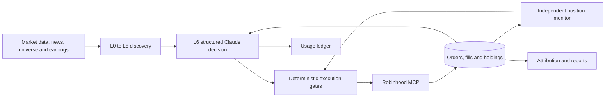
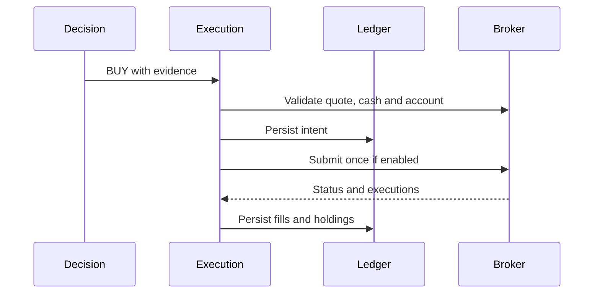
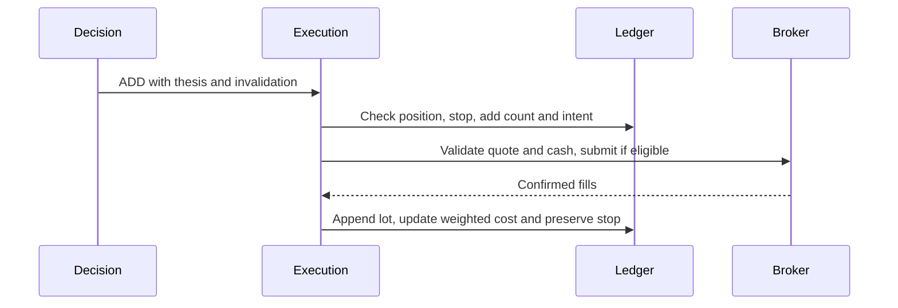
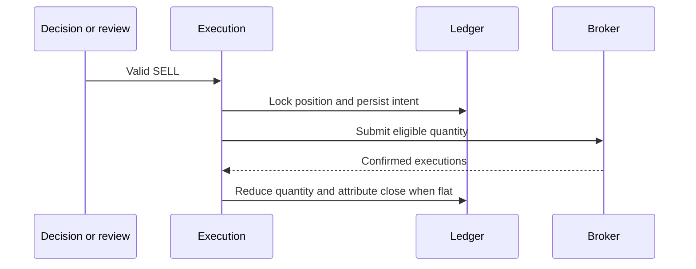
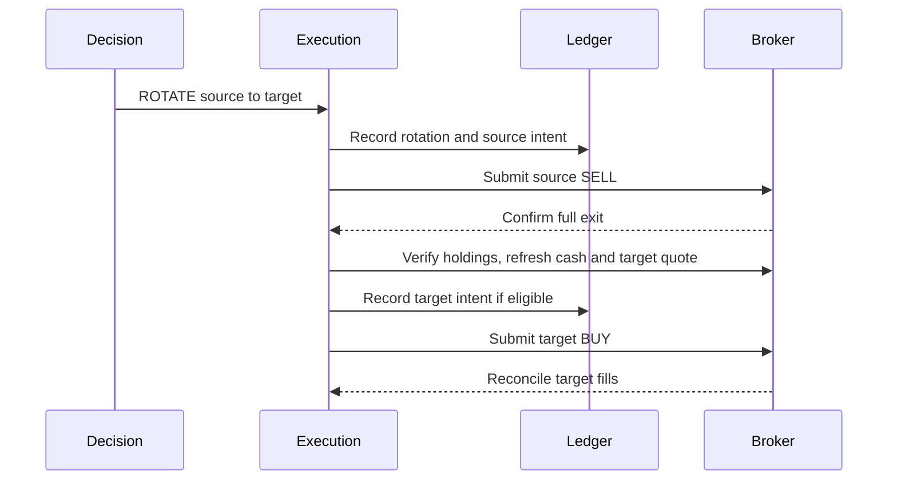
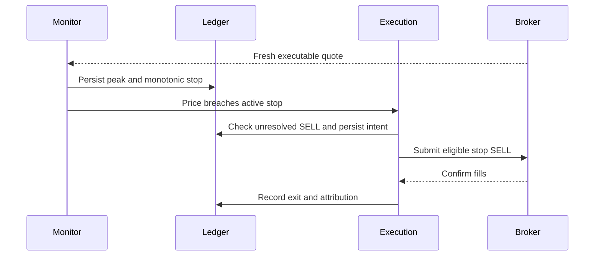

# End-to-end trading agent walkthrough

## A. Startup

Run `python main.py` from the repository root. The entry point takes an instance lock and starts `TradingAgent.start`. Configuration merges defaults and `config/settings.json`, then loads environment settings with dotenv. Validation errors prevent unsafe startup. The broker client reuses a valid cached OAuth token, attempts refresh when needed, and can perform dynamic registration and browser PKCE authentication on interactive startup. It selects exactly one eligible agentic account. The state store binds a fingerprint of that account on its first complete reconciliation and checks it on later reads.

Position and order state load before startup reconciliation. Persisted pending intents retain their state across restart. A complete, matching-account holdings read and order reconciliation are required before holdings are replaced. Startup installs the scheduler and monitor. Actual submissions require explicit live-release approval, dry run disabled, a healthy applicable execution gate, and an absent manual stop file. A failed dependency read blocks the operation that depends on it. An invalid OAuth session requires restoration before broker actions can resume.

## B. Inputs

| Input | Origin and use |
| --- | --- |
| Universe and symbols | Versioned S&P 500 snapshot and configured/legacy selection supply candidates. Open positions enter the held path independently. |
| Quotes | Robinhood bid, last, and source timestamp drive executable-price decisions. Eligibility and execution reject incomplete or stale observations where required. |
| Daily bars | Completed OHLCV bars supply returns, volatility, momentum, technical fingerprints and stops. |
| News | Finnhub articles supply timestamps, source IDs, headlines and finance sentiment. Missing evidence remains unavailable. |
| Broker account | Eligible accounts, holdings, buying power, orders and fills establish execution and position state. |
| Earnings | Sourced catalyst and point-in-time surprise/return history support the earnings archetype and optional PEAD advisory. |
| Time | Exchange calendar, quote times, order/fill times and session counts gate schedules and exits. |
| Configuration and state | Risk limits, dry-run and approval flags, stop file, persisted positions and order state. |
| Claude | Structured thesis and advisory decisions. Parsed decisions are inputs to deterministic execution gates. |

## C. Discovery L0–L6

| Layer | Calculation and outcome |
| --- | --- |
| L0 Universe | `core/discovery/universe.py` loads the versioned snapshot and its provenance. |
| L1 Eligibility | `gates.eligibility` checks price, liquidity, annual volatility, quote validity and history. |
| L2 Technical | At least 250 completed sessions. Returns use current close divided by the close n sessions earlier minus one for 5, 21, 63 and 126 sessions. Momentum is 0.6 × 21-session return + 0.4 × 63-session return. Features include 252-session high and runway, SMA20 and slope versus the prior SMA20, share of closes above SMA20, up-day volume share, recent/prior down-day volume, range and volatility contraction, distance from SMA20, Wilder RSI14 and ATR14, realized annual volatility and 30-session dollar volume. |
| L2 Fingerprints | F1 requires a positive 63-session return, SMA slope of at least 1%, close at least 97% of SMA20 and a 2–10% pullback from the 30-session high. F2 requires contraction ratios at or below 0.8 for range, volatility and down volume. F3 requires a 5–15% pullback from the 30-session high and down volume ratio at or below 0.8. |
| L3 News | Deduplicate by article identifier, URL and headline. Use a 7-day recent window, previous 7 days and a preceding 30-day count baseline. Give the newest 3 days twice the weight. Finance sentiment attempts FinSense ModernBERT and then finance DistilBERT. Held reviews use a temporal sentiment delta z-score when supported. |
| L4 Divergence | Clip each cohort feature at its mean ±3 standard deviations, then standardize. News score is the configured weighted sum of sentiment, velocity and delta z-scores. Price score is the momentum z-score plus weighted 5-session return z-score. Standardize news minus price across the cohort to obtain gap z-score. Persist entry reference data for later comparisons. |
| L4 Archetypes | A captures lagged favorable news with positive divergence and a technical fingerprint. B captures early inflection with basing and sentiment change. C captures confirmed drift with positive momentum and sentiment, a verified earnings catalyst and at least 3% runway. D marks unfavorable cases. Unclassified symbols may have no archetype. Deciles rank the cohort from low to high. |
| L5 Shortlist | Apply ranking, bucket quotas and deterministic ties to the new pool, default ten. Exclude held names, which get their own evaluation path. A failed refresh preserves prior data subject to staleness checks. |
| L6 Evaluation | Give Claude per-symbol candidate or holding context, evidence, roster and cycle type. Discovery is local before the decision step. |

These scores express a hypothesis about relative news and price behavior. The repository does not establish its out-of-sample predictive value.

## D. Claude decision-making

`DecisionEngine.make_decision` and `review_exit` assemble timestamped market, news, portfolio and position evidence. The structured response includes ticker, action, cycle, bull/bear cases, evidence references, thesis failure conditions, edge, and applicable add/rotation fields. Actions include BUY, SELL, HOLD, IGNORE, ADD and ROTATE. The application checks schema, action, identity, freshness and execution constraints independently. A timeout, malformed payload or unavailable model does not authorize an order. Free-form thesis claims require independent corroboration.

## E. Entry and execution

A BUY needs a valid decision, fresh matching live quote, available buying power and applicable release, reconciliation and exposure gates. The engine combines the edge ladder and volatility multiplier, caps the allocation and retains a cash buffer. Pending buys reserve remaining shares at their reference price. Confirmed buys since the cash snapshot also reduce availability. Before submitting, the engine persists its intent under execution locks. A definitive rejection ends that intent. An ambiguous response leaves it unresolved for reconciliation and prevents blind resubmission. Only confirmed fills establish lots, quantity and weighted cost. In dry run, preview results remain separate from live holdings.

## F. Position monitoring

The independent market-hours monitor defaults to 15 seconds. It examines matching fresh quotes, uses bid when available, updates peak, excursion and stop state, and reconciles broker state. Stale or out-of-order quotes cannot justify a new action. A valid hard stop bypasses Claude and specialized-review delays, subject to the operational broker gates. A gap through a stop triggers at the observable executable price. The fill may be worse than the stop level. A host or broker outage interrupts software-managed protection.

## G. E1–E12 and graduation

| Rule | Behavior |
| --- | --- |
| E1 | Entry stop uses the annual-volatility band, with default losses of 7%, 10%, 13% or 16% at the configured band boundaries. |
| E2 | At a peak at least 5% above entry, activate a floor at 100.5% of entry. |
| E3 | At a peak at least 10% above entry, use peak less three fresh ATR14 values. The ATR freshness window is five calendar days. |
| E4 | Keep the maximum of existing, initial and eligible trailing stops. Price at or through the active stop can submit a SELL without Claude. |
| E5 | Two completed closes below SMA20 after prior profitability queue technical review. |
| E6 | RSI at least 80 with a recent large gain, or a price over three standard deviations above the 20-session mean, tightens the eligible trail to peak less two ATR and queues review. |
| E7 | Adverse tone with temporal delta z at or below −1 and news velocity at or above 2 queues review. |
| E8 | At least ten sessions, absolute P&L under 2% and directional divergence progress under 25% queue stagnation review. |
| E9 | Compare against frozen entry-cohort data. Remaining signed gap at or below 0.3, or an inversion, queues review. Normalized progress uses one minus the signed current gap divided by the absolute entry gap, with clamping. |
| E10 | A sourced, point-in-time PEAD estimate with at least 30 prior comparable surprise-bucket events can queue review after at least five sessions when 80% of expected 15-session cumulative abnormal return is realized or the decay horizon is reached. Missing evidence leaves the trigger unavailable. |
| E11 | An alternative with an advantage of at least 0.8 on a comparable reference queues capital review. Rotation still needs independent approval and execution checks. |
| E12 | At least 15 sessions queues a time review. Age alone does not force liquidation. |

Specialized reviews use persisted cooldown and hysteresis, including volatility-aware drawdowns and renewed highs. The +20% milestone queues a one-time graduation review. An accepted HOLD keeps the position open under the existing stops and completes graduation. An accepted SELL still requires broker execution and confirmed fills. Incomplete reviews retry under their applicable rules. Partial profit-taking is disabled.

## H. Adds and rotations

ADD requires an explicit thesis and invalidation, current evidence, viable stop, allowed exposure, cooldown and count checks, and available cash. Actual added lots change weighted cost and preserve the existing stop ratchet. ROTATE verifies the source and target, requires a fresh source quote and submits the source SELL first. It requires a confirmed full exit and complete matching-account holdings before rereading buying power, refreshing the target quote and considering the target BUY. An ambiguous or deferred leg does not authorize automatic replay.

## I. Persistence and attribution

| Store | Purpose |
| --- | --- |
| `logs/positions.json` and backup | Versioned live state with account binding, positions, order intents, fills, events, reconciliations and rotations. Atomic replacement preserves restart recovery. Legacy records bind on first complete reconciliation. |
| `logs/paper_positions.json` | Separate paper state. |
| `logs/trades.json`, symbol journals and exit ledger | Decisions, evidence, review outcomes and reporting history. |
| Shortlist, features, sentiment and PEAD data | Candidate rankings, historical evidence and optional event statistics. |
| OAuth cache | Authentication continuity. Keep local and private. |
| Health, lock and stop files | Process heartbeat, duplicate-process prevention and operator control. |
| `cost_records_v2.jsonl` and `cost_summary_v2.json` | Usage events and derived rollup. |

`core/attribution.py` connects position, order and fill identifiers to entry archetype, gap, decile and evidence. It derives weighted gross P&L, available fee data, time held and lot-level maximum favorable/adverse excursion from recorded observations. Missing intervals and unavailable fees limit interpretation.

## J. Cost and API usage

The Anthropic wrapper records usage by attempt, model and rate version. Cost uses uncached input plus output, cache reads and separate cache-write durations with applicable modifiers. Missing usage remains unpriced. The application bounds retries for transient rate and overload responses. Decision cycles generally call per candidate or holding, while specialized grouped review can add calls. Hard stops and local discovery use no Claude calls. Provider reconciliation requires the same UTC window and billing dimensions as the local records.

## K. Schedule

Times are New York time by default. Startup reconciles and can catch up the eligible OPEN, MID or CLOSE cycle. The regular decision schedule is 09:35, 12:30 and 15:30, with the exchange calendar gating holidays and shortened sessions. The position monitor defaults to 15 seconds during market hours. Heartbeat is 30 seconds. The daily report runs at 16:05 and nightly maintenance at 20:00. Optional discovery refresh runs Sunday at 20:00, with the legacy selector configured separately. Decision cycles share a process-local lock. Monitoring remains independent.

## L. Shutdown and restart

Graceful shutdown stops scheduler work and cancels the background review worker. Durable order intents, fills, stop ratchets and unresolved rotations are recovered on the next start. Broker orders can remain open while the backend is down. Matching-account reconciliation is needed before new dependent actions. A pending intent with no confirmed broker identifier requires operator reconciliation. The scheduler lock prevents in-process overlap and does not provide durable cross-restart cycle deduplication.

## M. Architecture and execution sequences

### BUY

### ADD

### SELL

### ROTATE

### Hard stop

## N. Hypothetical lifecycle

A synthetic symbol enters the universe snapshot and passes liquidity, volatility and history gates. Completed bars show a pullback within a rising trend. New positive news lifts its standardized news score while price momentum lags. Its archetype earns a shortlist slot. Claude approves a BUY with a documented invalidation. The execution gate validates the quote, cash and exposure, and confirmed fills establish a $100 average cost. At $105 peak the stop can ratchet to $100.50. At $111 and an illustrative fresh ATR of $2, the three-ATR trail can lift it to $105. A $108 pullback above the stop can prompt thesis review if an advisory threshold is met. The stock recovers to $121 and the graduation review returns HOLD. Later a fresh bid breaches the active stop and the system records the actual SELL fills. With a $121 observed high and a $98 observed low, the position's observed excursions relative to $100 are +21% and −2%. The close records fill-based P&L, known fees and original entry attribution. All prices and decisions in this example are hypothetical.
